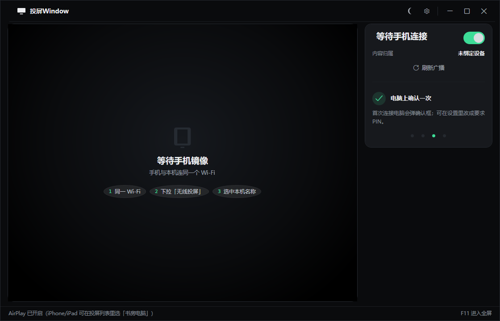
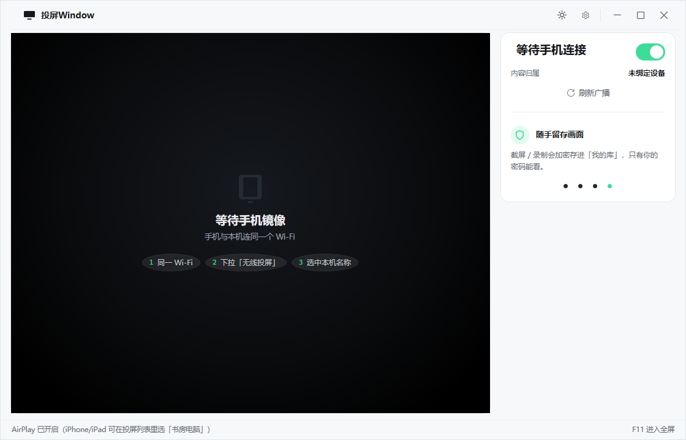
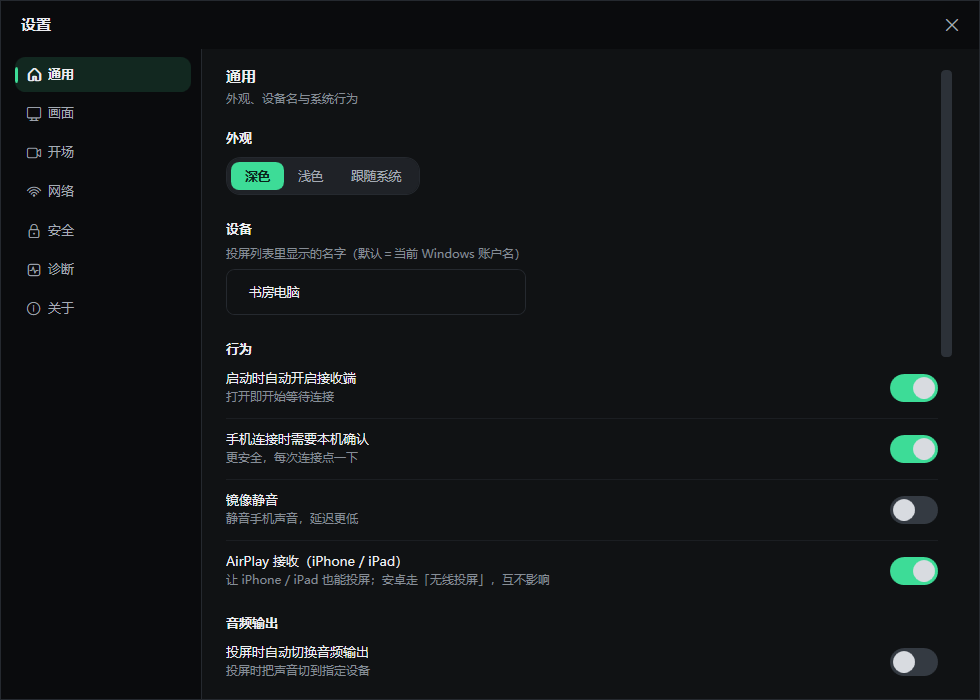
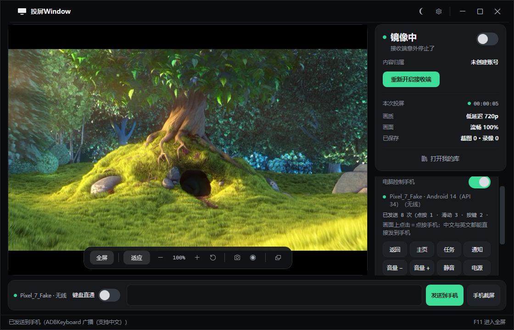

# 投屏Window 桌面版 · v2.1.0

把 Windows 电脑变成**手机镜像接收端**（Miracast / Wi-Fi Display，另支持 AirPlay 接收）。
手机和电脑连同一个 Wi-Fi，用手机自带的「无线投屏 / 投射屏幕」就能把画面镜像到电脑上。

**免费、非商业软件** · 作者：猪猪 · 反馈与新版本：QQ **2718860462**

[**⬇ 下载最新安装包**](https://github.com/Oldfoollearnc/CastReceiver/releases/latest) ·
[更新日志](CHANGELOG.md) · [安全与隐私评估](docs/安全与隐私评估.md) · [常见问题](#常见问题)



## 亮点

| | |
| --- | --- |
| **装完即用** | 安装包自带 .NET 10 运行时与 WPF，约 **59 MB**，装到当前用户目录，**不需要管理员权限** |
| **电脑控制手机** | 安卓 11+：在投屏画面上直接点按 / 滑动 / 打字，手机端零操作（**默认关闭**，见下） |
| **截图录像加密** | 磁盘上不留任何明文，只有在本程序里输账号密码才能看；多账号互相隔离 |
| **反截屏保护** | 会议共享、录屏软件、远程协助截本窗口只会得到黑屏 |
| **投屏自愈** | 偶发投不上会自己重建会话；换 Wi-Fi 后自动重新放行并重启接收端 |
| **低延迟** | 向手机申请 720p@4Mbps 低延迟流、GPU 零拷贝呈现；延迟优先 / 画质优先可热切换 |

## 截图

| 主界面（深色） | 主界面（浅色） |
| --- | --- |
|  |  |

| 设置 | 电脑控制手机 |
| --- | --- |
|  |  |

> 「电脑控制手机」那张是**桩手机**跑出来的界面（真实渲染，界面与真机一致）。

## 安装与使用

1. **下载安装**：到 [Releases](https://github.com/Oldfoollearnc/CastReceiver/releases/latest) 下载
   `CastReceiver-Setup-2.1.0.exe`，双击 → 下一步 → 完成。
2. **放行一次**：启动后如果顶部显示黄色的「还差一步：点『一键准备』」，点它并在 UAC 弹窗里同意一次
   （放行防火墙 + 允许被手机发现，**只需一次**）。
3. **开始镜像**：手机下拉快捷面板 →「无线投屏 / 投射屏幕」→ 在设备列表里选本机名称。
   手机开始连接时电脑端会立刻显示「手机正在连接…」。

**改设备名**：设置 → 通用 → 设备名，改完**自动重新广播**（失焦即生效），手机重新搜索就能看到新名字，
**不需要重启程序**；有设备正在投屏时会提示「断开后生效」。

> **重复双击**：程序已在运行时不会再弹「已在运行」对话框，而是直接把已有窗口唤到前台。

## 电脑控制手机（安卓 · 默认关闭）

手机投上来之后，**在投屏画面上直接操作手机**，手机端**不需要任何操作**——投上来那一刻自动完成
「发现 → 连接 → 打开控制」。

| 能做什么 | 怎么做 |
| --- | --- |
| 点按 / 滑动 / 上下滚 | 鼠标在画面上：点击＝点按，按住拖动＝滑动，滚轮＝上下滑 |
| 系统键 | 侧栏 12 颗键：返回 / 主页 / 最近任务 / 音量 ± / 静音 / 电源 / 亮屏 / 息屏 / 通知栏 / 菜单 / 粘贴 |
| 送一段文字到手机 | 底部控制条输入框 →「发送到手机」（回车也行） |
| 用电脑键盘打字 | `Ctrl+Alt+K` 打开「键盘直通」；中文请用上面的输入框 |
| 截手机的屏 | 「手机截屏」→ **加密存进「我的库」** |

> ⚠️ **默认关闭，界面上不出现任何入口**。要用请先打开 **设置 → 安全 →「电脑控制手机（安卓）」**。
> 关着的时候程序**完全不碰 adb**：不启动 adb 进程、不搜索手机、不轮询。打开后不需要重启程序。

**唯一的前置条件**：手机打开「设置 → 开发者选项 → **无线调试**」（需要 **Android 11 及以上**）。
**首次**在一台新手机上用，手机点一次「使用配对码配对设备」，把 6 位配对码抄进程序弹出的窗口
（IP 与端口已自动填好）；配对过之后就是「手机投上来就能控制」。

手机没开「无线调试」时，电脑端**无论做什么都连不上**——这是安卓的安全要求，任何同类工具都一样；
程序会把当前状态逐秒写在底部状态栏，不让你对着「没反应」猜。

> 隐私：连接是**手机与电脑之间的局域网直连**，不经过任何服务器；手机上会显示「已连接到调试」，
> 你随时可以在手机上关掉「无线调试」断开。中文输入需要手机装
> [ADBKeyboard](https://github.com/senzhk/ADBKeyBoard)（开源输入法）；没装时程序**明确提示并拒绝发送**，不会静默丢字。

## 加密库与隐私

**投屏、截屏、录制都不用输密码；要看截图和录像，必须输密码。** 密码不是软件里的一道开关，
而是加密学意义上的钥匙——把整个库拷到别的电脑也解不开。

第一次点「截屏」「录制」或「我的库」时创建一个账号（账号名 + 密码，至少 8 位含字母数字）。
之后内容以 AES-256-GCM 逐帧加密入库，**磁盘上不会出现任何明文文件**；关闭库窗口、按 `Ctrl+Alt+L`、
或空闲超过设定分钟数会**立即上锁**（内存里的密钥清零）。

- **一个账号一套密钥、一个独立的库**：账号 A 看不到账号 B 的内容。
- **投屏设备决定内容归属**：第一次遇到某台手机会问你一次「这台设备归入哪个账号」，之后自动归入。
- **反截屏保护**（默认开）：其他程序截本程序窗口只会得到黑屏。
- **投屏侧隐私加固**：连接/断开默认不写日志、界面默认不显示手机名、默认禁止其他设备抢占投屏、
  始终拒绝发送端反向键鼠控制。
- **隐私体检**（设置 → 安全）：逐项检查 Game Bar 后台录制、Windows 回忆（Recall）、旧版明文文件、
  `%TEMP%` 明文帧残留、云盘同步范围等，能一键修的直接修。

完整的风险分析、做不到的事、建议的系统设置清单见 **[docs/安全与隐私评估.md](docs/安全与隐私评估.md)**。

## 常见问题

**手机搜不到电脑？** ① 是否点过「一键准备」并同意 UAC；② 网络位置是否为「专用」；③ 是否同一个 Wi-Fi；
④ 路由器是否开了 AP 隔离；⑤ 是否开着移动热点（会占用 Wi-Fi Direct，界面会橙字提示，可一键关闭）。

**手机点投屏后一直连不上？** 先等 25 秒——看门狗会自动重建会话（界面显示「正在自动恢复」）。
仍不行就点「重启接收端」；再不行关闭再打开一次手机 Wi-Fi（复位 Wi-Fi Direct 协议栈）。

**画面有黑边？** 竖屏手机镜像到宽屏必然留黑。点「铺满画面」裁切填满，或直接「全屏」（会自动铺满）。

**觉得不够跟手？** 用「延迟优先」+「镜像静音」，并确认手机与电脑在同一个 **5GHz** 频段（2.4GHz 会标黄提示）。

## 从源码构建

需要 **.NET 10 SDK**；要打安装包还需要 [Inno Setup 6](https://jrsoftware.org/isinfo.php)。

```powershell
# 只出绿色版（自包含，可直接运行）
powershell -ExecutionPolicy Bypass -File build.ps1

# 发布 + 打安装包（默认不含开场视频，约 59 MB）
powershell -ExecutionPolicy Bypass -File build.ps1 -Installer

# 安装包也带上开场视频（约 250 MB）
powershell -ExecutionPolicy Bypass -File build.ps1 -Installer -InstallerWithIntro
```

版本号的唯一来源是 `Directory.Build.props` 的 `<Version>`，不用再去 `.iss` 里手工改。

跑自检（不需要界面 / 网络 / 手机）：

```powershell
dotnet run --project tests\CastReceiver.SelfTest\CastReceiver.SelfTest.csproj -c Release -- --vault-only
```

> **开场素材**：`assets/intro/builtin-intro.mp4`（约 191 MB）**不在仓库里**（体积大，且超过 GitHub
> 单文件上限），需要自己放进去；没有素材时程序会跳过入场动画。详见 [assets/intro/README.md](assets/intro/README.md)。

## 系统要求

- **Windows 10 版本 2004（内部版本 19041）或更高 / Windows 11，x64**
- 支持 Miracast 的无线网卡（绝大多数笔记本内置网卡都支持）
- 「电脑控制手机」需要手机 **Android 11 及以上**，并在手机上打开「无线调试」

## 文档

| 文档 | 内容 |
| --- | --- |
| [CHANGELOG.md](CHANGELOG.md) | 逐版本改动 |
| [docs/安全与隐私评估.md](docs/安全与隐私评估.md) | 加密库、反截屏、投屏隐私的风险分析 |
| [assets/intro/README.md](assets/intro/README.md) | 内置开场素材的规格与重新裁剪方法 |
| [docs/](docs/) | 界面截图 |

## 许可

本程序为**免费、非商业软件**，没有商业授权版本、没有任何收费形式。
第三方组件与许可明细见安装目录下的《第三方声明》；自带 adb 来自 Google platform-tools（Apache-2.0）。

---

作者：**猪猪** · 反馈 / 新版本：**QQ 2718860462**
